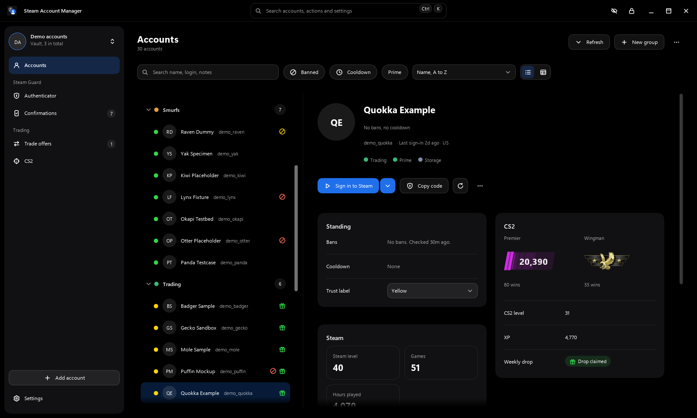
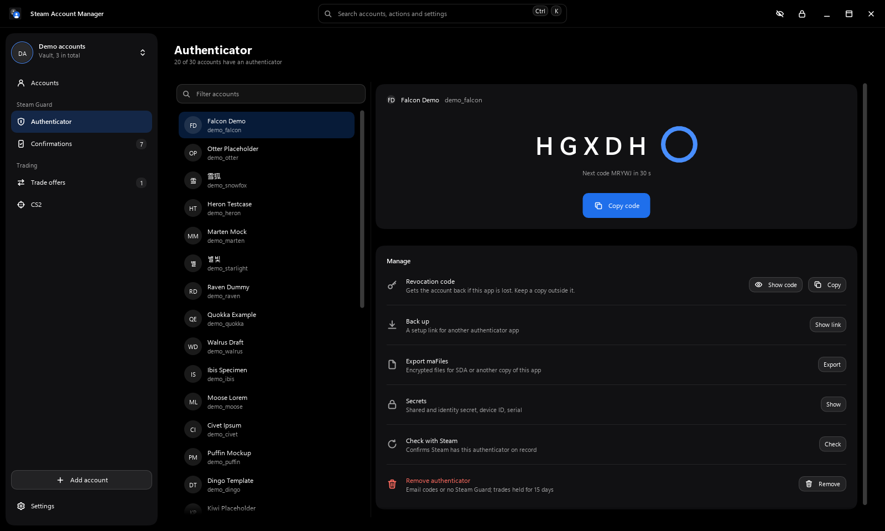
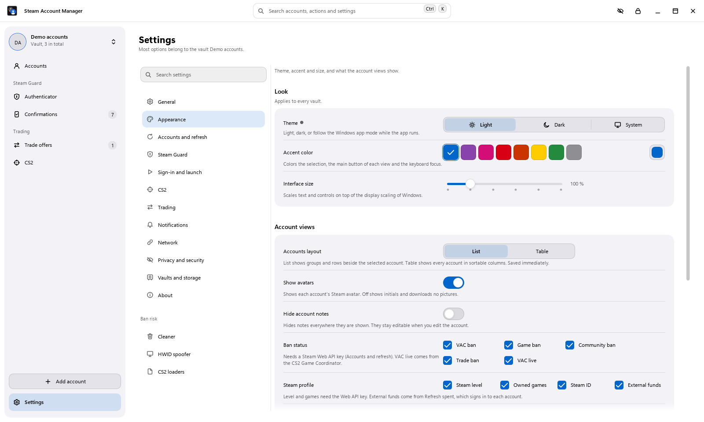

<div align="center">

# Steam Account Manager

[](https://github.com/velyndev/steam-account-manager/actions/workflows/build.yml)
[](../../releases)
[](../../releases)
[](LICENSE)


A native Windows manager for your Steam accounts: encrypted vaults, Steam Guard
codes, mobile confirmations, trade offers, CS2 tools, and one-click sign-in.

<details>
<summary><b>Show screenshots</b></summary>
<br>

<br><br>

<br><br>

</details>

Keep your accounts in one or more local vaults encrypted with your master password.
No installer and no telemetry, and the vaults never leave your machine.

</div>

## Features

### Interface
- The title bar holds a search field that opens the command palette (**Ctrl+K**). It finds
  every screen, every account in the vault, the Settings categories, and actions such as
  Refresh all accounts, Lock vault and privacy mode.
- Beside it sit the privacy mode switch (**Ctrl+Shift+P**) and Lock vault (**Ctrl+L**). While
  safe mode or streamproof mode is on, an indicator for it shows there too; clicking it opens
  the setting.
- The sidebar starts with the vault switcher, then Accounts, a **Steam Guard** group
  (Authenticator, Confirmations) and a **Trading** group (Trade offers, CS2). Pending
  confirmations and incoming offers are counted on their items. Add account and Settings sit
  at the bottom. In a narrow window the sidebar shrinks to an icon rail.
- Background work (account refreshes, CS2 pulls, funds, confirmation checks, a cleaner run)
  shows as an activity item at the bottom of the sidebar, only while it runs; hovering or
  clicking it lists every job. An update notice appears there only when a newer release is
  out and you have not skipped it. There is no status bar.
- **Ctrl+1** to **Ctrl+5** open Accounts, Authenticator, Confirmations, Trade offers and CS2,
  **Ctrl+N** opens Add account, **Ctrl+,** opens Settings, and **Ctrl+/** lists every shortcut.
- Toasts report results. A toast about an account or a setting opens it when clicked.
- Appearance: theme (Light, Dark, or System, which follows the Windows app mode while the app
  runs; Dark by default), an accent color, and an interface size from 0.75x to 2x on top of the
  Windows display scaling. All three apply to every vault and preview as you change them.
- Settings has one search across every category, with the number of hits per category. Most
  changes wait for **Save** (Ctrl+S) or **Discard**; switches that take effect at once, such as
  privacy mode or safe mode, save themselves. The Cleaner, HWID spoofer and CS2 loaders
  categories are listed apart, under Ban risk.

### Vaults
- Keep separate sets of accounts in independent encrypted vaults (personal, trading, clients),
  each with its own master password, accounts and settings. Options marked "Applies to every
  vault" in Settings are shared.
- Give each vault a name, a color, and a custom image icon in Settings > Vaults and storage,
  where vaults are also created and deleted.
- With several vaults the unlock screen lists them all. One vault can open at startup, which
  skips the choice when it can open without the password.
- **Create a new vault** on the unlock screen adds a vault next to the existing ones. It never
  overwrites the vault that was selected.
- Switch vaults from the vault switcher at the top of the sidebar. The app restarts on the other
  vault.

### Accounts
- Two layouts, switched in the toolbar: a list of collapsible, color-coded groups beside the
  selected account's details, or a table of every account with sortable, hideable columns and
  the selected account in a side pane.
- The details show the account's standing (bans, cooldown, trust label), its Steam and CS2
  data, notes and recent changes, with **Sign in to Steam**, **Copy code** and refresh at the
  top.
- Search by name, login or notes, filter to banned, cooldown or Prime accounts, and sort by
  name, login, last sign-in, Premier rating, Steam level, CS2 level, XP, spend, cooldown or
  weekly drop.
- Select several accounts with Ctrl+click and Shift+click, or with Select all shown accounts.
  The details pane then offers the bulk actions: export the selection, or remove it (which asks
  first).
- Right-click an account to copy its login, password, Steam Guard code, SteamID64, profile link,
  CS2 friend code or trade link, open it in your browser already signed in, edit it, change its
  Steam name, move it to a group, apply the CS2 config, mark the weekly drop, export or remove
  it. Right-click a group to rename, recolor or delete it.
- Per-account password, notes, tags and trust label (green / yellow / red).
- Privacy mode hides every login until you click to reveal one; reveals last until the vault
  locks.
- NFA (token-only) accounts: the sign-in token's expiry is shown and flagged in its last week,
  a check reports whether Steam still accepts it, and the token can be replaced in Edit account.
  They sign in without a password.

### Import and export
- Add account offers six ways in: sign in with the password (the full mobile login, with a
  Steam Guard code or an approval in the Steam app), import maFiles (one or a whole folder),
  take an account signed in to Steam on this PC, paste an NFA token, import an SDA `info.dat`,
  or import a bundle. maFiles, `info.dat` files and bundles can also be dropped on the window.
- Imports of several accounts show a preview of what is added or replaced before anything is
  written.
- Passphrase-protected `.samvault` bundle to carry accounts between machines: export from an
  account's menu or from a selection, and import through Add account.

### Authenticator
- Steam Guard codes for every account with an authenticator, with the next code. Filter the
  list by typing; Up and Down choose an account and Enter copies its code.
- Optional global shortcut copies the selected account's code from any app.
- Hide-the-code-until-clicked and copy-on-select options, with clipboard auto-clear.
- Link an authenticator in-app: Steam sends an activation code by SMS or email. Before the flow
  continues to activation you tick that you wrote the revocation code down outside the app.
  **Finish later** leaves it half linked, to be finished from the Authenticator screen.
- Remove an authenticator with its revocation code, switching the account to email codes or
  turning Steam Guard off. Steam then holds trades and market listings for 15 days.
- Back up an authenticator as a setup link for another authenticator app, export encrypted
  `.maFile` files for SDA or another copy of this app, view its secrets, or check that Steam
  has it on record.

### Confirmations
- One list of mobile confirmations across every account (trades, market listings, phone
  number changes, account recoveries, feature opt-outs), filterable by account.
- Approve or deny one, or select several. Approving a single item happens at once, except an
  account recovery or a phone number change, which asks first with a warning. Every deny asks
  first.
- Bulk approve asks first and leaves account recoveries and phone number changes out, unless
  you tick the box that includes them.
- Accounts that could not be checked are listed under Needs attention with their fix (link the
  maFile, sign in again, retry). Scan a folder of maFiles to add missing identity secrets.
- Optional background check on a timer, with a toast when new items arrive.
- Optional auto-approve, off by default, for your own market listings and for phone number
  changes. Matching items are approved as soon as they are fetched. Trades are never approved
  automatically, and nothing is denied automatically.
- Every decision, yours or auto-approve's, goes to a local history you can search, kept for a
  number of days you set.

### Trade offers
- Incoming, Sent and History tabs, for every account or one. An offer's items, message and
  trade hold show in a side pane.
- Offers are read only when you press Refresh, because Steam limits how often they can be read.
- Accept, decline, or cancel a sent offer (cancel asks first). Accepting an offer in which you
  give items and receive nothing asks first. Accept all asks first and names the offers that
  give items away.
- Send items in four steps (accounts, destination, items, review), from several accounts at
  once: every tradable item or the ones you pick. Sent offers are confirmed automatically
  unless you turn that off.
- Saved trade links and a default destination, managed in Settings > Trading.
- The History tab keeps the offers you sent from the app, with their outcome, for 90 days.
- Copy an account's own trade link from its menu. It is fetched once and reused for a week.

### Account review
- Per-account VAC / game / community / trade ban flags, Steam level, and owned games. These
  need a free Steam Web API key, entered in Settings > Accounts and refresh and saved as plain
  text in the vault's `settings.json` (see [SECURITY.md](SECURITY.md)).
- CS2 Premier rating, Wingman rank, level and competitive cooldown, read from the account's
  CS2 pages on Steam (GCPD, needs a full login). VAC live comes from the CS2 Game Coordinator.
- Prime status. Steam tells only the account itself, so it is exact once the account has
  connected to the CS2 Game Coordinator (on the CS2 screen, or in the check token-only
  accounts get on refresh). Until then it is an estimate from the CS2 level and XP, shown as
  "Likely" or "Unknown".
- External funds (total spend) per account, read from Steam Support with one sign-in per account.
- New bans, cooldown changes, and VAC live flips surface as marks in the account list, in-app
  toasts, and optional Windows tray notifications, and are logged. Every indicator is toggleable.

### CS2 (Game Coordinator)
- The CS2 screen connects one account to the Game Coordinator: level and XP, medals and coins,
  weekly mission progress, and the weekly drop. **Claim** stays disabled until every pick is made.
- View the live inventory and move items in and out of storage units.
- Refresh CS2 data for all accounts from the Accounts screen's Refresh menu, or at launch: one
  account signs in and fetches the other accounts' medals and level by account ID, while
  token-only accounts are checked one by one. Data newer than the cache window you set is
  skipped.
- Turn the CS2 connection off in Settings > CS2 and the screen leaves the sidebar.

### Launch
- One-click sign-in: closes Steam, relaunches, and types the login and Steam Guard code via
  UI Automation, falling back to the clipboard with auto-clear.
- Or sign in without the login window by injecting a client-scoped JWT into Steam's
  ConnectCache. NFA accounts always use this, with no password or code typing.
- The default sign-in method is set in Settings > Sign-in and launch. The arrow next to
  **Sign in to Steam** overrides it for one account until the app restarts, and sets what
  happens after sign-in for that account: stay in Steam, launch CS2, or launch CS2 with an
  external loader.
- Copy a `video.txt` or a whole `730` folder into the account's CS2 config on login.
- Or point it at a `userdata\<id>` folder and every game folder in it (`730`, `570`, `440`, ...)
  is copied on login. Steam's own per-account settings are left alone.
- Set CS2 launch options once and have them written for whichever account you launch.
- Optionally turn off Steam Cloud, new-release news, or Remote Play, or sign in as invisible,
  for each account you launch. Existing files are backed up first.
- Optionally block a launched account's subscribed CS2 workshop maps from downloading, so it
  goes straight into the game. Subscriptions are kept.
- Open any account in your browser, already signed in, from the right-click menu.

### Tracer cleaner
- Wipes what Steam leaves on the PC, as one of three profiles: **Quick Clean** (caches,
  logs, crash dumps), **Account Reset** (adds saved logins, the ConnectCache login tokens
  in `config.vdf` / `local.vdf`, ssfn files, the HKCU autologin values, per-account caches),
  or **Full Wipe** (adds each account's whole `userdata` folder). Choosing Full Wipe asks first.
- A keep list decides what survives. Tick any vault account, or any Steam login found on this
  PC, and its saved login, `userdata`, registry subtree, avatar and login token are spared.
  `loginusers.vdf` and the ConnectCache are edited entry by entry rather than deleted, so kept
  accounts stay signed in. Everything unticked is signed out.
- Runs on demand, or automatically before every sign-in, when the vault is unlocked, or when
  the app closes. The pre-launch trigger fires while Steam is already down, so it never fights
  the sign-in.
- Preview first: the exact list of files, registry values and VDF entries, with sizes. **Run the
  cleaner** stays disabled until a preview is built and the cleaner settings are saved, and
  asks before it starts. There is no backup and no undo.
- **Clean Steam caches** in the Accounts screen's More actions menu runs the Quick Clean
  profile after a confirmation, whatever the Cleaner settings say. It signs nobody out.
- Gated by safe mode: with safe mode on the Cleaner settings are hidden and no trigger fires, and
  your profile and keep list are kept for when you turn it back off.

### HWID spoofer (educational purposes only)
- Injects a DLL into the Steam process on launch that hooks WMI, SMBIOS, DXGI, D3D9, and
  display APIs to present spoofed hardware identifiers.
- Spoofable components: machine GUID, MAC address, disk serial, PC name, GPU, motherboard,
  RAM, monitor, storage, and sound card, each individually toggleable.
- Per-account hardware profiles: each account gets its own randomly generated profile, or is
  excluded from spoofing entirely, from its right-click menu.
- "Spoof every launch" applies a profile to every launch; the per-component mask picks exactly
  which identifiers are replaced.
- Hardware comparison table in Settings shows real vs. spoofed values side by side.

### Background refresh
- Refresh every account on launch, or schedule a logon task (Settings > General) that
  refreshes in the background and notifies on new bans or cooldown changes.
- Optional periodic auto-refresh while the app is open, updating only accounts whose cached
  data has expired.
- The logon task can instead just open the app, optionally minimized.
- Optional update check on launch, against the GitHub releases page. No account data is sent.
  A newer release offers Remind me later, Skip this version, or Open releases page.

### Privacy and security
- Vault encrypted with AES-256-GCM under PBKDF2-HMAC-SHA256 (600,000 iterations). No recovery
  path. Optional DPAPI auto-unlock skips the master-password prompt on launch.
- The vault locks after the idle time you set, and copied passwords and codes are cleared from
  the clipboard after the delay you set.
- Safe mode hides and disables everything that can get an account banned: the HWID spoofer, the
  external CS2 loaders and the tracer cleaner all leave the interface, no launch injects or runs
  them, and no cleaner trigger fires. Set per vault, and reversible. Turning it off asks first.
  Nothing is erased, so turning it off restores everything.
- Optional administrator elevation, on by default. Only the Windows-logon task and controlling
  an elevated Steam need it, so most setups can turn it off and never see a UAC prompt again.
- Streamproof mode hides the window from screen-capture software (OBS, Discord, Snipping Tool)
  while it stays fully visible on your monitor.
- Per-account or single proxy (SOCKS5 / HTTP / HTTPS, with credentials) and a test button.
- Portable mode (a `portable.flag` file next to the exe keeps the data in a `data` folder beside
  it) and a data folder you can move, for example to a USB stick, in Settings > Vaults and
  storage.
- No telemetry. Details in [SECURITY.md](SECURITY.md).

## Download

Grab the latest `steam-account-manager.exe` from the [Releases](../../releases) page.
It is statically linked, so no Visual C++ redistributable is required.

- **Requirements:** Windows 10 or 11, 64-bit. The app asks for administrator on launch,
  which you can turn off in Settings > General if you don't need the Windows-logon task
  (see [Privacy and security](#privacy-and-security)).
- **First run:** the binary is unsigned, so SmartScreen may show "Windows protected
  your PC". Click **More info**, then **Run anyway**.
- On first launch you set a master password (there is no recovery), then add an account.

## Build from source

```powershell
git clone https://github.com/velyndev/steam-account-manager.git
cd steam-account-manager
.\scripts\init_third_party.ps1
start steam-account-manager.sln   # build Release | x64
```

Vendored dependencies are fetched by the script, so there is no vcpkg or submodule
setup. The build also needs CMake 3.28 or newer for the Facet UI framework. See
[CONTRIBUTING.md](CONTRIBUTING.md) for prerequisites, the project layout, and the
vendored-library list.

## Security

Account secrets live in an AES-256-GCM vault keyed from your master password, stored
only on your machine. Settings, including the Steam Web API key and a single proxy's
address, are plain JSON next to it. There is no recovery path and no telemetry. To
report a vulnerability or read the full security model, see [SECURITY.md](SECURITY.md).

## Contributing

Pull requests are welcome. See [CONTRIBUTING.md](CONTRIBUTING.md).

## Disclaimer

This project is for managing your own accounts and for educational and research
purposes, and is not affiliated with Valve or Steam. The HWID spoofer component is
provided for educational purposes only. You are responsible for how you use this
software, and it must not be used to violate the Steam Subscriber Agreement, any
game's terms, or applicable law. See [DISCLAIMER.md](DISCLAIMER.md).

## License

[MIT](LICENSE). The libraries the binaries contain, and the notices their licenses ask for,
are listed in [THIRD_PARTY_NOTICES.md](THIRD_PARTY_NOTICES.md).
